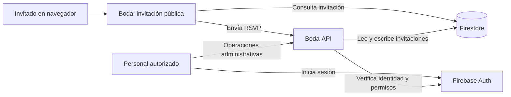

# Boda

Aplicación web para una invitación de boda personalizada y la gestión de sus confirmaciones de asistencia (RSVP). El repositorio contiene la invitación pública; la administración y la API viven en repositorios separados.

## 1. Propósito

Boda presenta los detalles del evento y permite que cada grupo invitado consulte su invitación mediante un enlace personalizado y registre su respuesta. El panel Boda-Admin administra invitaciones, mientras que Boda-API valida y persiste las operaciones.

## 2. Funcionalidades implementadas

### Invitación pública

- Portada y página del evento con historia, cuenta regresiva, galería, ubicación, itinerario, código de vestimenta y sugerencias de regalos.
- Carga de invitaciones mediante su identificador en la ruta pública.
- Formulario RSVP para personas identificadas y lugares abiertos, con capacidad para confirmar asistencia, indicar que nadie asistirá cuando solo hay lugares abiertos y dejar lugares disponibles sin asignar.
- Sustitución de invitados cuando la invitación lo permite, restauración del invitado original y envío de un mensaje.
- Mensajes de resultado y errores de guardado comunicados en el formulario.

### Administración y API

- Boda-Admin incluye inicio de sesión con Firebase Auth, tablero de métricas, creación, consulta, búsqueda y filtrado de invitaciones.
- Permite editar datos admitidos, ajustar capacidad, importar invitaciones desde Excel, gestionar sustituciones y archivar o restaurar invitaciones.
- Boda-API ofrece endpoints públicos para RSVP y rutas administrativas protegidas, además de documentación OpenAPI/Swagger.

## 3. Arquitectura



En desarrollo, la guía local conecta los clientes y la API a Firebase Emulator Suite usando el proyecto de demostración `demo-boda`. Boda consulta Firestore para cargar la invitación y envía las respuestas RSVP a la API. Boda-Admin autentica al usuario con Firebase Auth y llama a las rutas protegidas de la API.

## 4. Tecnologías

- **Boda:** React, TypeScript, Vite, React Router, Tailwind CSS, Firebase Web SDK, Motion y Lottie.
- **Boda-API:** Node.js, TypeScript, Express, Firebase Admin SDK y Vitest.
- **Boda-Admin:** React, TypeScript, Vite, React Router, Firebase Web SDK, Tailwind CSS, Vitest y ExcelJS/SheetJS para importación.
- **Calidad y pruebas:** Oxlint, Vitest, Firebase Emulator Suite y Playwright con Chromium/Chrome.

Las versiones y scripts vigentes están definidos en el `package.json` de cada repositorio. Boda-API declara Node.js `24.x`.

## 5. Requisitos e instalación local

Para el flujo integrado con emuladores se necesita Node.js 24.x, npm, Java (requerido por Firestore Emulator) y los tres repositorios como carpetas hermanas:

```text
Proyecto/
├── Boda/
├── Boda-API/
└── Boda-Admin/
```

Instala las dependencias una vez en cada repositorio:

```powershell
# Ejecuta en cada una de las carpetas Boda, Boda-API y Boda-Admin
npm ci
```

No se requiere copiar credenciales al repositorio. Los `.env` locales deben mantenerse fuera de Git.

## 6. Variables de entorno

Los nombres siguientes se verificaron en los `.env.example` y en el código. Los valores dependen del entorno y no deben copiarse desde otra instalación.

| Proyecto | Variables utilizadas |
|---|---|
| Boda | `VITE_API_BASE_URL` es obligatoria para enviar RSVP. `VITE_USE_FIREBASE_EMULATORS` habilita el modo emulador explícito; acepta `true` o `false` y solo puede ser `true` en desarrollo. |
| Boda-Admin | `VITE_API_BASE_URL` y `VITE_PUBLIC_INVITATION_BASE_URL`; también requiere `VITE_FIREBASE_API_KEY`, `VITE_FIREBASE_AUTH_DOMAIN`, `VITE_FIREBASE_PROJECT_ID`, `VITE_FIREBASE_STORAGE_BUCKET`, `VITE_FIREBASE_MESSAGING_SENDER_ID` y `VITE_FIREBASE_APP_ID` fuera del modo emulador. `VITE_USE_FIREBASE_EMULATORS` activa ese modo en desarrollo. |
| Boda-API | `PORT`, `FIREBASE_PROJECT_ID`, `ADMIN_FIREBASE_UIDS` y `CORS_ALLOWED_ORIGINS`. Para emuladores también: `NODE_ENV=development`, `USE_FIREBASE_EMULATORS=true`, `FIRESTORE_EMULATOR_HOST` y `FIREBASE_AUTH_EMULATOR_HOST`. |

**Nota de configuración:** los seis nombres `VITE_FIREBASE_*` aparecen en el `.env.example` de Boda, pero el código actual de Boda no los consume; su configuración Firebase normal está definida en `src/firebase/firebase.ts`. Boda-Admin sí lee esas variables cuando no está en modo emulador. En modo emulador, Boda y Boda-Admin utilizan configuración ficticia de `demo-boda`.

Para una configuración local aislada, utiliza las instrucciones exactas de [docs/local-emulator.md](docs/local-emulator.md). La API exige un UID autorizado en `ADMIN_FIREBASE_UIDS`; en el procedimiento de emulador se usa únicamente el UID local de Auth Emulator.

## 7. Ejecutar Boda y conectarlo a Boda-API

La API local escucha por defecto en el puerto `3000`. En modo emulador se limita a `127.0.0.1`. El procedimiento completo requiere cuatro terminales PowerShell, con Firestore y Auth Emulator activos.

1. **Terminal 1 — Firebase Emulator Suite**, desde la carpeta Boda:

   ```powershell
   npm exec -- firebase emulators:start --only auth,firestore --project demo-boda
   ```

2. **Terminal 2 — Boda-Admin**, para iniciar sesión localmente y obtener un UID de Auth Emulator:

   ```powershell
   Set-Location ..\Boda-Admin
   $env:VITE_USE_FIREBASE_EMULATORS = 'true'
   $env:VITE_API_BASE_URL = 'http://127.0.0.1:3000'
   $env:VITE_PUBLIC_INVITATION_BASE_URL = 'http://127.0.0.1:5173'
   npm run dev -- --host 127.0.0.1 --port 5174 --strictPort
   ```

   Abre `http://127.0.0.1:5174` e inicia sesión con el flujo de Google simulado por Auth Emulator. No se autentica con una cuenta real de Google.

3. **Terminal 3 — Boda-API**, sustituye el texto de ejemplo por el UID local obtenido en Emulator UI:

   ```powershell
   Set-Location ..\Boda-API
   $env:NODE_ENV = 'development'
   $env:USE_FIREBASE_EMULATORS = 'true'
   $env:FIREBASE_PROJECT_ID = 'demo-boda'
   $env:FIRESTORE_EMULATOR_HOST = '127.0.0.1:8080'
   $env:FIREBASE_AUTH_EMULATOR_HOST = '127.0.0.1:9099'
   $env:ADMIN_FIREBASE_UIDS = 'UID_LOCAL_DEL_EMULADOR'
   $env:CORS_ALLOWED_ORIGINS = 'http://127.0.0.1:5173,http://127.0.0.1:5174'
   $env:PORT = '3000'
   npm run dev
   ```

4. **Terminal 4 — Boda**, desde la carpeta del repositorio Boda:

   ```powershell
   $env:VITE_USE_FIREBASE_EMULATORS = 'true'
   $env:VITE_API_BASE_URL = 'http://127.0.0.1:3000'
   npm run dev -- --host 127.0.0.1 --port 5173 --strictPort
   ```

Boda queda disponible en `http://127.0.0.1:5173`; Auth Emulator UI en `http://127.0.0.1:4000`. Los puertos de emulador son Firestore `8080` y Auth `9099`. Para apagar el entorno, presiona `Ctrl+C` en cada terminal.

Las variables `$env:` afectan solo a la terminal actual. En modo emulador, los clientes validan que las URLs de API y de invitación pública sean locales; la API requiere `demo-boda` y ambos hosts de emulador configurados. Si alguna validación falla, no inicies la prueba.

## 8. Pruebas

Desde la raíz de Boda:

```powershell
npm test
npm run test:rules
```

- `npm test` ejecuta Vitest y excluye las pruebas de reglas y la carpeta E2E.
- `npm run test:rules` arranca Firestore Emulator mediante Firebase CLI para probar `firestore.rules` con el proyecto `demo-boda`.
- `npm run test:e2e` ejecuta Playwright (`scripts/e2e/playwright.config.mjs`). Requiere Boda, Boda-Admin, Boda-API, Auth Emulator y Firestore Emulator previamente iniciados con la configuración de [docs/local-emulator.md](docs/local-emulator.md). El preflight verifica el proyecto, los hosts locales y las aplicaciones antes de seguir; los datos creados por E2E se limpian en el teardown.

En Boda-API y Boda-Admin, ejecuta `npm test` desde la raíz de cada repositorio. La integración E2E está alojada en Boda y cubre recorridos visibles de creación, RSVP, sustitución y restauración.

## 9. Estructura principal

```text
Boda/
├── docs/                 # Guía del entorno local con emuladores
├── public/               # Recursos públicos estáticos
├── rules-tests/          # Pruebas de reglas de Firestore
├── scripts/e2e/          # Configuración y recorridos Playwright
└── src/
    ├── firebase/         # Acceso a invitaciones, configuración y RSVP
    ├── layouts/          # Componentes de disposición y restricciones de dispositivo
    ├── page/HomePage/    # Secciones del evento y formulario RSVP
    ├── page/InvitationPage/
    └── routes/           # Rutas públicas
```

Los repositorios relacionados separan las responsabilidades: Boda-API organiza rutas, controladores, servicios, validaciones y pruebas; Boda-Admin organiza autenticación, tablero e invitaciones, incluyendo su API cliente e importación.

## 10. Build y despliegue

Build de Boda:

```powershell
npm run build
```

El script ejecuta `tsc -b` y `vite build`, y genera `dist/`. Para servir localmente ese build:

```powershell
npm run preview
```

Boda-Admin tiene los mismos scripts `build` y `preview`. Boda-API usa `npm run build` para compilar TypeScript a `dist/` y `npm start` para ejecutar `dist/server.js`; requiere la configuración de entorno correspondiente.

No hay una configuración de hosting o un comando de despliegue definido en el `firebase.json` de Boda: contiene configuración de reglas, índices y emuladores. Por ello, este README no prescribe un destino ni un comando de publicación.

## 11. Estado de Fase 1 y limitaciones conocidas

La Fase 1 implementa los flujos centrales de invitaciones y RSVP en los tres repositorios, con pruebas unitarias, validaciones contra Firebase Emulator y recorridos Playwright mantenidos en Boda. La operación local integrada depende de iniciar los emuladores y las tres aplicaciones con el mismo proyecto `demo-boda`.

Limitaciones verificadas:

- La guía de emuladores cubre Auth y Firestore; no configura emuladores para Functions, Storage u otros servicios.
- Boda tiene configuración Firebase normal en el código y no consume actualmente las variables `VITE_FIREBASE_*` listadas en su `.env.example`.
- El repositorio de Boda no define la infraestructura ni los pasos de despliegue. Los comandos anteriores verifican compilación y preview local, no publicación.
- Playwright espera un Chrome/Chromium local; la configuración busca Chrome instalado o el ejecutable indicado por `PLAYWRIGHT_EXECUTABLE_PATH`.
